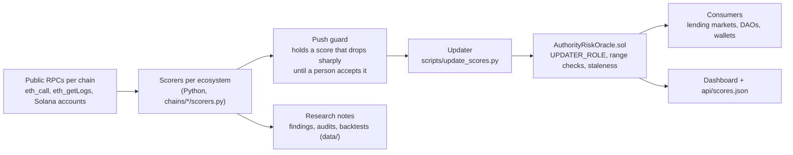

<p align="center">
  
</p>

<h1 align="center">Authority Risk Oracle</h1>

<p align="center"><b>Who can really move a DeFi protocol's funds? An on-chain oracle that answers, on 8 EVM chains, in one call any contract can make (on Solana, by reading an account).</b><br><sub>9 on-chain oracles (8 EVM testnets and Solana devnet), plus Zcash Testnet as a hash commitment: 10 ecosystems, 197 tracked contracts. Composite = 40% admin key + 30% multisig + 30% timelock; price feed and shared control are published beside it. On the EVM oracles the call is <code>getScore(address)</code>; on Solana the score is an account (PDA, seeds <code>["score", target]</code>), read by account.</sub></p>

<p align="center">
  <a href="LICENSE"></a>
  <a href=".github/workflows/test.yml"></a>
  <a href=".github/workflows/watch.yml"></a>
  <a href=".github/workflows/mutation.yml"></a>
  
  <a href="https://realspap.github.io/oracle/"></a>
  
  <a href="watch/API.md"></a>
</p>

<p align="center">
  <a href="https://realspap.github.io/oracle/">Dashboard</a> ·
  <a href="#deployed-oracles">Deployed oracles</a> ·
  <a href="METHODOLOGY.md">Methodology</a> ·
  <a href="#read-a-score-from-a-contract">Integrate</a> ·
  <a href="docs/LANDSCAPE.md">How it compares</a> ·
  <a href="docs/OPERATIONS.md">Operate it</a>
</p>

<p align="center"><b>Live:</b> <a href="https://realspap.github.io/oracle/">live dashboard</a></p>

Submitted to Colosseum's [Crypto World's Fair](https://colosseum.com/worldsfair) on 12 October 2026.

Most DeFi exploits are not code bugs. They are one admin key, one thin multisig, or one missing timelock. Risk providers
that look at this are paid by the protocols they rate, or sell a closed dashboard. This project computes the answer
independently, from public chain state, and **publishes it on-chain**, so a lending market, a DAO or a wallet can read it
and act on it without trusting anyone's website.

- **Five sub-scores per protocol**: admin-key concentration, multisig strength, timelock delay, oracle-signer authority
  and shared signers across protocols (0 = one bare key can do anything, 100 = no unchecked power found).
- **Two view functions**: `getScore(address)` and `isStale(address)`. A consumer contract can freeze collateral behind a weak
  authority and refuse a stale read outright ([`ExampleConsumer.sol`](src/ExampleConsumer.sol) does exactly that).
- **Every number is re-derived live** on every run, from one public RPC per chain, and a second RPC that cross-checks the reads that matter most (mainly Ethereum L1 and its tokens). The only values not re-read are the dated snapshots and pins listed in the methodology. The methodology states
  what the oracle cannot see, next to what it can.

## Try it in 60 seconds

**1. Read a score, no install beyond [Foundry](https://getfoundry.sh)** (Robinhood Chain testnet, target: a tracked Uniswap v3 factory):

```bash
cast call 0x9BF45734D09bC7CA39238e767B2af9AAc62a7f52 \
  "getScore(address)(uint8,uint8,uint8,uint8,uint8,uint8,uint64,bytes32)" \
  0x1f7d7550B1b028f7571E69A784071F0205FD2EfA \
  --rpc-url https://rpc.testnet.chain.robinhood.com/rpc
# adminKey, multisig, timelock, oracleAuthority, crossExposure, composite, lastUpdated, methodologyHash
# 80, 100, 75, 100, 80, 85, 1791664867, 0x795edc64...   (read live on 2026-10-11; the last two values change at every push)
```

**2. Open the dashboard**: [realspap.github.io/oracle](https://realspap.github.io/oracle/), one table for the 197 tracked contracts on 9 chains
(8 EVM testnets and Solana devnet), re-read from the oracles every 6 hours by a read-only job. It shows the money behind each
setup, the timelock queue before a change applies, the alerts that fire on rules you can fork, why a score moved, and one static
page per contract. Every score can be re-read from the chain in your browser ("verify all live"). `/oracle/` is a generated build of the dashboard plus the site shell; its base,
[`dashboard/index.html`](dashboard/index.html), is a single file with no backend; the watch files are under [`watch/`](watch/API.md).

**3. Audit it yourself, then ask it questions.** Standard library only, no network unless a line says so.

- `python3 scripts/tour.py` is the thirty-second tour: run it first after cloning.
- `python3 scripts/audit_public.py` checks the hash-chained event log, the signed manifest and the schemas, and re-reads scores from the oracles. `watch/status.json` is the run health in one record. The manifest is signed with the maintainer's Ed25519 key `11baca3ef6a69de4901c185f6cbbd3f93318fbb74f9961a8d39aead841adf409` (the dashboard pins it): a manifest signed by another key is not ours.
- `python3 scripts/consistency.py` checks that the published files describe the same contracts and the same counts (each file passes its schema on its own; this is the check between them).
- `python3 scripts/dossier.py base 0x...` prints everything the watch knows about one contract, in words, from a clone and with no network.
- `python3 scripts/brief.py morpho-blue` writes a one-page brief for a protocol on all its chains: weakest deployment, fewest keys, shortest reaction, money counted once per chain, and what was not read.
- `python3 scripts/find.py --kind eoa --min-money 1e8` asks a question of every tracked contract at once. A value the watch did not read excludes the row and is counted, never matched as a zero; `--csv` gives the rows to a spreadsheet; `--watchlist mine.txt --alert --fail-if-any` is a gate for a cron job that exits 3 when a rule fires on one of your contracts.
- `python3 scripts/compare.py morpho-blue aave-v3 lido` sets protocols side by side, or chains with `--chains`; every figure says on how many contracts it was read. Each protocol can show its own badge in its README (`watch/badge/protocol/<slug>.json`, its weakest tracked deployment).
- `python3 scripts/whatif.py base 0x... --timelock 75` shows what the published formula gives if a sub-score changed (arithmetic, not a prediction).
- `python3 scripts/authority_check.py --chain base --address 0x... --min-score 60` is a CI gate: it fails when a contract you depend on is not tracked, is stale, is under your minimum or is falling (`--max-drop 10`). As a GitHub Action: `uses: RealSpap/authority-risk-oracle-showcase@main` with `chain`, `address`, `min-score` (see [`action.yml`](action.yml)).
- `python3 scripts/conformance.py <twin.json | folder>` checks any implementation's JSON labels against the open Authority Facts v0.1 format ([`watch/schema/label.schema.json`](watch/schema/label.schema.json)): fields, band, formula, and that an unread value is `null`, never 0. The local MCP server (`scripts/mcp_server.py`) has a `check` tool for an agent that must decide before depending on a contract.
- `python3 scripts/mcp_server.py --watch watch` is the same data as a local, read-only MCP server for an AI agent (stdio, no account, no key, no network).
- `python3 scripts/watch_age.py --max-hours 14` is a watchdog for a cron or an uptime monitor: exit 1 if the last run is too old, 2 if its age cannot be established.
- `python3 scripts/mutate.py` replays the mutations listed in `scripts/tests/mutations.json` (break the code one way, see whether the tests notice) and counts a mutant that does not run as invalid, never as caught. The `Mutation` workflow replays them every week and turns red when one survives.
- `python3 scripts/demo.py` replays four invented events (a pause, a shorter delay announced, an idle admin Safe waking up, a balance collapse) on a copy of the data and runs the real scripts, so you can see the alerts, the review queue and the dossier react.
- One Atom feed per protocol (`watch/feed/protocol/<slug>.xml`) lets a team follow every chain of its protocol at once.
- For programs and monitors: `watch/catalog.json` lists every published file with the question it answers, `watch/metrics.prom` is the run in the Prometheus text format (a stopped watch is `time() - aro_run_timestamp_seconds > 8 * 3600`), and the site publishes an `llms.txt`.

**4. Pull Robinhood Chain's table as JSON** (63 of the tracked targets; `python3 scripts/live_target_counts.py` counts every oracle), with the transaction that produced it so you can cross-check it:

```bash
curl -s https://raw.githubusercontent.com/RealSpap/authority-risk-oracle-showcase/main/api/scores.json | jq '.txHash, (.scores | length)'
```

**5. Ask a question the score alone does not answer** (read-only, public RPC, no key):

```bash
pip install -r scripts/requirements.txt
python3 scripts/who_controls.py --top 20          # the most connected signers across every tracked protocol (about a minute: it reads nine oracles live)
python3 scripts/incident_exposure.py              # how many targets score at or below the multisig behind a documented incident (about two to three minutes)
```

## What it scores

| Sub-score | The question it answers | Worst case |
|---|---|---|
| `adminKeyScore` | Who holds the upgrade / admin authority: a bare key, a Safe, a governance system? | one EOA |
| `multisigScore` | If a multisig: how many signers must agree, out of how many? | 1-of-N |
| `timelockScore` | Is there an enforced delay between a queued action and its effect? | no delay |
| `oracleAuthorityScore` | Who can change the prices the target reports or reads? | one price key |
| `crossExposureScore` | Does the same committee also control another tracked protocol? | shared across chains |

`compositeScore = floor(0.4 * admin + 0.3 * multisig + 0.3 * timelock + 0.5)`. The last two scores are published next to the
composite and deliberately not folded into it: a consumer may weigh them differently. Full derivation, inputs and
limits: [`METHODOLOGY.md`](METHODOLOGY.md).

**New in this release: the price path.** A lending market is only as safe as whoever can move the price it reads. The scorers now
walk each market's price sources one hop upstream (Chainlink proxies, rate providers, Chronicle and Pyth feeds, Morpho and Euler
oracles) and score the weakest controller among the paths that carry at least 1% of the market's supply, with timelocks, DAO
windows and code-bounded levers handled explicitly. It covers Aave V3 and its forks, Compound V3, Morpho V1 and V2, Euler V2,
Fluid, Dolomite, Moonwell, Radiant, GMX and Kamino and Jupiter Lend on Solana. Details and the live results:
[`METHODOLOGY.md`](METHODOLOGY.md#oracleauthorityscore-for-price-consumers).

## Deployed oracles

Read live on 2026-10-11 with `python3 scripts/live_target_counts.py` (`trackedTargetsCount()` on each oracle). 197 targets on 9 on-chain oracles,
plus 6 Zcash targets attested through on-chain commitments (Zcash has no contract VM).

| Ecosystem | Network | Oracle | Targets |
|---|---|---|---|
| Robinhood Chain | Testnet, chain 46630 | [`0x9BF4...7f52`](https://explorer.testnet.chain.robinhood.com/address/0x9BF45734D09bC7CA39238e767B2af9AAc62a7f52) | 63 |
| Ethereum L1 | Sepolia, chain 11155111 | [`0xB6F8...f906`](https://sepolia.etherscan.io/address/0xB6F8474ccC71AF477c31c2DF663B3942ddfbf906) | 34 |
| Arbitrum | Sepolia, chain 421614 | [`0x5084...8720`](https://sepolia.arbiscan.io/address/0x50840a7667baEa9D05ad4ae3dCeb384724b58720) | 13 |
| Base | Sepolia, chain 84532 | [`0x5084...8720`](https://sepolia.basescan.org/address/0x50840a7667baEa9D05ad4ae3dCeb384724b58720) | 13 |
| Tempo | Moderato, chain 42431 | [`0x5084...8720`](https://explore.testnet.tempo.xyz/address/0x50840a7667baEa9D05ad4ae3dCeb384724b58720) | 14 |
| Plasma | Testnet, chain 9746 | [`0x5084...8720`](https://testnet.plasmascan.to/address/0x50840a7667baEa9D05ad4ae3dCeb384724b58720) | 9 |
| Monad | Testnet, chain 10143 | [`0x5084...8720`](https://testnet.monadvision.com/address/0x50840a7667baEa9D05ad4ae3dCeb384724b58720) | 9 |
| Hyperliquid | HyperEVM testnet, chain 998 | `0x5084...8720` (no public explorer for this network) | 16 |
| Solana | Devnet, native Anchor program | [`5VhiTA...Yh4W`](https://explorer.solana.com/address/5VhiTAGLEViGgajhxPbzdWz7WLUAiRy42DY6qi6tYh4W?cluster=devnet) | 26 |
| Zcash | Testnet, no contract | [latest OP_RETURN commitment](https://testnet.cipherscan.app/tx/462de12bf72e5e635a1feed4a4cedb02c03f17745bd15176787f8f5f8fcd701c) | 6 attested |

The six EVM oracles at `0x5084...8720` share one address by construction (the same deployer was at nonce 0 on each chain).
The targets are real mainnet protocols; the oracles that publish their scores run on testnets while the stack is validated.

## Read a score from a contract

```solidity
interface IAuthorityRiskOracle {
    struct AuthorityScore {
        uint8 adminKeyScore; uint8 multisigScore; uint8 timelockScore;
        uint8 oracleAuthorityScore; uint8 crossExposureScore; uint8 compositeScore;
        uint64 lastUpdated; bytes32 methodologyHash;
    }
    function getScore(address target) external view returns (AuthorityScore memory);
    function isStale(address target) external view returns (bool);
}

// in your lending market
IAuthorityRiskOracle.AuthorityScore memory s = oracle.getScore(collateralProtocol);
require(!oracle.isStale(collateralProtocol), "authority score stale");   // an old score is no score
uint256 factorBps = s.compositeScore < 60 ? 0 : 5000 + (uint256(s.compositeScore) - 60) * 3000 / 40;   // the rule of ExampleConsumer below: 0 under 60, then 50% at 60 rising to 80% at 100
```

A fuller consumer, with its tests, is [`src/ExampleConsumer.sol`](src/ExampleConsumer.sol). Only an address holding `UPDATER_ROLE`
can write; every sub-score is range-checked on-chain (`ScoreOutOfRange`), a gap found by this project's own review of its contract
against the LlamaGuard pattern ([`data/contract_review_2026-09-17-llamaguard-comparison.md`](data/contract_review_2026-09-17-llamaguard-comparison.md)).

## How it works



1. **Score**: each ecosystem's scorer re-derives every target from live chain state (owners, thresholds, modules, proxy admins,
   timelock delays, price sources), with a second RPC cross-checking the reads that matter most (Ethereum L1 and its tokens).
2. **Guard**: a push that lowers a score by more than 15 points, or that follows a read that could not be completed, is held until
   a person looks at it. An unreadable source takes a conservative score and is held, not reported as safe.
3. **Publish**: the updater writes a batch on-chain with a `methodologyHash` derived from the code that produced it
   (`scripts/lib/methodology.py`), so a consumer can tell a scorer fix from a real change in the target's keys.
4. **Read**: any contract calls `getScore`; the dashboard and `api/scores.json` do the same for people.

## What is verified on-chain, and what is not

| Claim | Where it lives | How to check it |
|---|---|---|
| The scores a consumer reads | contract storage | `getScore(target)` |
| Who may write a score | `UPDATER_ROLE` | `hasRole(UPDATER_ROLE, address)` |
| A score is not too old | contract | `isStale(target)` |
| Which code produced a batch | `methodologyHash` | recompute with `python3 scripts/lib/methodology.py <ecosystem> --label <label>` from a commit of the private working repository; the digest of this public copy differs (see "Built during the hackathon") |
| Zcash scores | OP_RETURN commitments on Zcash testnet | [`chains/zcash/`](chains/zcash/) |
| The inputs (keys, thresholds, delays) | public chain state, re-read at scoring time | each scorer and every dated audit in `data/` |
| The classification rules | documented heuristics, tested | [`METHODOLOGY.md`](METHODOLOGY.md) |

## Evidence

- **Backtests on real incidents**: the formula applied to the configuration behind Drift ([`data/backtest_2026-09-17-drift-protocol-security-council-compromise.md`](data/backtest_2026-09-17-drift-protocol-security-council-compromise.md)),
  Wasabi ([`data/backtest_2026-09-17-wasabi-protocol.md`](data/backtest_2026-09-17-wasabi-protocol.md)) and Solend ([`data/backtest_2026-09-17-solend-governance-emergency-powers.md`](data/backtest_2026-09-17-solend-governance-emergency-powers.md)).
- **Adversarial review and published corrections**: every batch is re-checked by a separate pass told to refute it, and
  errors are published as `data/correction_*.md` rather than edited away.
- **2,800+ unit tests** (Python, offline) plus the Solidity suite in `test/`. Run them with the commands below.
- **Read-only watch tools** that answer what a score alone does not (stale oracles, Safe changes, queued timelock operations,
  signer-kind changes, TVL coverage): [`docs/OPERATIONS.md`](docs/OPERATIONS.md).

## Beyond the hackathon: who it is for

Authority risk is not a hackathon problem. The losses that hurt DeFi most (one admin key, a thin multisig, no timelock) keep repeating, and
the risk is still sold as a closed service, paid by the protocol it rates. This repository is built to be used, not only judged:

| If you are | What you use | How |
|---|---|---|
| A lending market, a vault or a curator | `getScore` and `isStale` as a listing and exposure gate | Import the interface; [`src/ExampleConsumer.sol`](src/ExampleConsumer.sol) derives a collateral factor, freezes collateral behind a weak authority and refuses a stale or missing score outright |
| A DAO risk committee or a delegate | The Watch: the timelock queue before a change applies, Safe changes, signer-kind changes, alerts on rules you can fork | The [dashboard](https://realspap.github.io/oracle/) and the [`watch/`](watch/API.md) files, refreshed every 6 hours; [dispute a score](https://github.com/RealSpap/authority-risk-oracle-showcase/issues/new?template=dispute.yml) and the dispute is recorded in the event log |
| An auditor, an insurer or a researcher | Open data you can re-derive | [`api/scores.json`](api/scores.json), [`watch/API.md`](watch/API.md) and the dated notes in [`data/`](data/README.md): every number comes from public chain state read on public RPCs (one per chain, a second one for some Ethereum L1 reads), with the method written down |
| A builder on another chain | A pattern, not a product | One scorer file per ecosystem ([`chains/`](chains/README.md)); add a target, pin its score with a test, push through the dry-run-first script |

Where it goes next, stated plainly:

1. **Mainnet.** The oracles run on testnets today. A mainnet release needs the updater key behind a multisig, timestamps taken from the chain
   (see Limitations below) and an external audit of the contract.
2. **A standing mandate.** DAOs already pay for live risk monitoring ([`BUSINESS.md`](BUSINESS.md)), and none of it covers authority risk. No
   insurer or institution was found paying for a continuous authority feed: this is a bet on latent demand, not a sold product.
3. **A standard.** ERC-8241 (Protocol Control Disclosure) standardizes the raw facts of who controls what and leaves scoring to external layers.
   This oracle is built to be that layer.
4. **More targets, one at a time.** The list is chosen by what people actually hold and lend against, and every addition is read and tested.

## How it compares

Neighbouring tools, one row each (what each reads and what it does not, from its own pages): [realspap.github.io/oracle/compare](https://realspap.github.io/oracle/compare/). One source builds that page; this README does not repeat it.

The longer comparison, including what SolGov and LlamaRisk do better and where this project is still thin, is in
[`docs/LANDSCAPE.md`](docs/LANDSCAPE.md). The business case is in [`BUSINESS.md`](BUSINESS.md).

## Limitations, stated plainly

- **Testnet publication.** The oracles run on testnets with one updater key while the stack is validated; the targets are mainnet
  protocols. A mainnet deployment would move the updater to a multisig first.
- **Trust in the updater.** A consumer trusts whoever holds `UPDATER_ROLE` to publish what the scorers computed. The
  `methodologyHash`, the public code and the push guard make a bad push detectable, not impossible.
- **Coverage is partial.** 197 targets is a fraction of DeFi TVL; `python3 scripts/check_tvl_coverage.py` measures it per ecosystem (slow: about 15 minutes, and it prints nothing until the end).
- **Heuristics.** Classifying an account (EOA, Safe, DAO, timelock) and bounding a lever are judgments, documented and tested, not proofs.
- **Freshness is not continuous.** Scores are pushed on a cadence; `isStale` tells a consumer when to stop trusting one.
- **The contract has had no external audit.** It is small (see [`src/`](src/)) and was reviewed against the LlamaGuard pattern by this project itself.
- **On the EVM oracles, freshness is the updater's word.** `lastUpdated` is the timestamp the updater pushes, not `block.timestamp`, so a compromised or buggy updater key can keep a score looking fresh, and an extreme value makes `isStale` revert on an overflow. The Solana program reads the cluster clock instead. A mainnet version should take the time from the chain; [`test/AuthorityRiskOracle.t.sol`](test/AuthorityRiskOracle.t.sol) states this behaviour in two `test_Limitation_*` tests.
- **A fresh Solana deployment must be initialised in the same transaction as the deploy.** `initialize` has no authority check, so on a new deployment whoever calls it first becomes admin and updater. The devnet registry was initialised by the operator.
- **The Robinhood push script now refuses to send anywhere but Robinhood Chain testnet** (and to read anywhere but its mainnet), and `Deploy.s.sol` requires `EXPECTED_CHAIN_ID`: a wrong URL cannot write to a mainnet by accident.

## How it was built, and what came before

The repository started on 2026-09-15 as a private working repository; the public history here is a sequence of dated snapshots of that
work (the earliest days are folded into the first snapshots, and a few findings still under responsible disclosure are left out). The scoring logic reuses
classification code from two earlier research programs by the same author:
[`multisig-overlap`](https://github.com/RealSpap/multisig-overlap-showcase) and
[`defi-admin-key-risk`](https://github.com/RealSpap/defi-admin-key-risk-showcase). Everything in this repository (contract, ten
ecosystems' scorers, updater, push guard, dashboard, tests) was built from 2026-09-15 onwards.
`methodologyHash` is derived from the bytes of the scorer files, so the digest of this public copy differs from hashes published by
pushes made from the working repository; a push made from a commit of this repository publishes this repository's digest.

## Repository map

| Path | What is in it |
|---|---|
| [`src/`](src/), [`test/`](test/), [`script/`](script/) | the oracle contract, the example consumer, Foundry tests, the deploy script |
| [`chains/`](chains/) | one folder per ecosystem: scorers, deploy records, dated audits, methodology notes ([map](chains/README.md)) |
| [`scripts/`](scripts/) | the updater, the push guard, shared libraries (`scripts/lib/`), watch tools and their tests |
| [`dashboard/`](dashboard/), [`api/`](api/) | the single-file dashboard and the JSON snapshot of the last push |
| [`watch/`](watch/API.md), [`rules.json`](rules.json) | the read-only watch: scores every 6 hours, TVL, timelock queue, alerts and their rules, why a score moved, an independent second reader that publishes its disagreements with the score, public disputes, share cards, feeds, whether a contract is paused or its balance collapsed, who holds its secondary roles and what its admin Safe has executed, a review queue of what needs a person, a machine-readable catalogue and Prometheus metrics |
| [`data/`](data/) | findings, corrections, backtests and snapshots ([index](data/README.md)) |
| [`METHODOLOGY.md`](METHODOLOGY.md), [`CHANGELOG.md`](CHANGELOG.md), [`BUSINESS.md`](BUSINESS.md) | how scores are derived, the dated history, the market case |
| [`docs/`](docs/) | [landscape](docs/LANDSCAPE.md) and [operations](docs/OPERATIONS.md) |

## Develop and test

```bash
forge install foundry-rs/forge-std OpenZeppelin/openzeppelin-contracts --no-git
forge test

pip install -r scripts/requirements.txt
python3 -m unittest discover -s scripts/lib/tests
python3 -m unittest discover -s scripts/tests
```

Deploying needs `PRIVATE_KEY` in the environment, never committed: `EXPECTED_CHAIN_ID=46630 forge script script/Deploy.s.sol --rpc-url robinhood --broadcast`.
Every deploy script defaults to a dry run and refuses a chain whose `eth_chainId` is not the expected one.
Report a vulnerability as described in [`SECURITY.md`](SECURITY.md).

## License

Code: [MIT](LICENSE). Data (the files under `watch/`, the share pages and their JSON twins): CC BY 4.0, attribution "Authority Risk Oracle, realspap.github.io/oracle" with a link.
