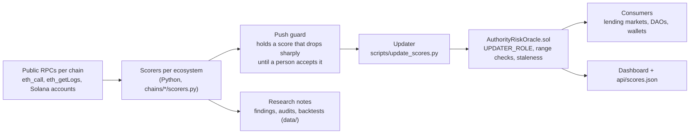

# Authority Risk Oracle: reference

The full reference, moved here from the front page of the repository. The front page is the [README](../README.md).

<p align="center"><b>Who can really move a DeFi protocol's funds? An on-chain oracle that answers, on 8 EVM chains, in one call any contract can make (on Solana, by reading an account).</b><br><sub>9 on-chain oracles (8 EVM testnets and Solana devnet), plus Zcash Testnet as a hash commitment: 10 ecosystems, 202 tracked contracts. Composite = 40% admin key + 30% multisig + 30% timelock; price feed and shared control are published beside it. On the EVM oracles the call is <code>getScore(address)</code>; on Solana the score is an account (PDA, seeds <code>["score", target]</code>), read by account.</sub></p>

<p align="center"><b>Live:</b> <a href="https://realspap.github.io/oracle/">live dashboard</a></p>

Submitted to Colosseum's [Crypto World's Fair](https://colosseum.com/worldsfair) on 12 October 2026.

Most DeFi exploits are not code bugs. They are one admin key, one thin multisig, or one missing timelock. Risk providers
that look at this are paid by the protocols they rate, or sell a closed dashboard. This project computes the answer
independently, from public chain state, and **publishes it on-chain**, so a lending market, a DAO or a wallet can read it
and act on it without trusting anyone's website.

- **Five sub-scores per protocol**: admin-key concentration, multisig strength, timelock delay, oracle-signer authority
  and shared signers across protocols (0 = one bare key can do anything, 100 = no unchecked power found).
- **Two view functions**: `getScore(address)` and `isStale(address)`. A consumer contract can freeze collateral behind a weak
  authority and refuse a stale read outright ([`ExampleConsumer.sol`](../src/ExampleConsumer.sol) does exactly that).
- **Every number is re-derived live** on every run, from one public RPC per chain, and a second RPC that cross-checks the reads that matter most (mainly Ethereum L1 and its tokens). The only values not re-read are the dated snapshots and pins listed in the methodology. The methodology states
  what the oracle cannot see, next to what it can.

## What it scores

| Sub-score | The question it answers | Worst case |
|---|---|---|
| `adminKeyScore` | Who holds the upgrade / admin authority: a bare key, a Safe, a governance system? | one EOA |
| `multisigScore` | If a multisig: how many signers must agree, out of how many? | 1-of-N |
| `timelockScore` | Is there an enforced delay between a queued action and its effect? | no delay |
| `oracleAuthorityScore` | Who can change the prices the target reports or reads? | one price key |
| `crossExposureScore` | Does the same committee also control another tracked protocol? | shared across chains |

**The composite is computed on three of the five sub-scores** (admin key, multisig, timelock). Read all five, not only the composite.

`compositeScore = floor(0.4 * admin + 0.3 * multisig + 0.3 * timelock + 0.5)`. The last two scores are published next to the
composite and deliberately not folded into it: a consumer may weigh them differently. Full derivation, inputs and
limits: [`METHODOLOGY.md`](../METHODOLOGY.md).

**New in this release: the price path.** A lending market is only as safe as whoever can move the price it reads. The scorers now
walk each market's price sources one hop upstream (Chainlink proxies, rate providers, Chronicle and Pyth feeds, Morpho and Euler
oracles) and score the weakest controller among the paths that carry at least 1% of the market's supply, with timelocks, DAO
windows and code-bounded levers handled explicitly. It covers Aave V3 and its forks, Compound V3, Morpho V1 and V2, Euler V2,
Fluid, Dolomite, Moonwell, Radiant, GMX and Kamino and Jupiter Lend on Solana. Details and the live results:
[`METHODOLOGY.md`](../METHODOLOGY.md#oracleauthorityscore-for-price-consumers).

## Deployed oracles

Read live on 2026-10-22 with `python3 scripts/prove.py` (`trackedTargetsCount()` on each oracle; `python3 scripts/live_target_counts.py` prints the same counts). 202 targets on 9 on-chain oracles,
plus 6 Zcash targets attested through on-chain commitments (Zcash has no contract VM).

| Ecosystem | Network | Oracle | Targets |
|---|---|---|---|
| Robinhood Chain | Testnet, chain 46630 | [`0x9BF4...7f52`](https://explorer.testnet.chain.robinhood.com/address/0x9BF45734D09bC7CA39238e767B2af9AAc62a7f52) | 63 |
| Ethereum L1 | Sepolia, chain 11155111 | [`0xB6F8...f906`](https://sepolia.etherscan.io/address/0xB6F8474ccC71AF477c31c2DF663B3942ddfbf906) | 39 |
| Arbitrum | Sepolia, chain 421614 | [`0x5084...8720`](https://sepolia.arbiscan.io/address/0x50840a7667baEa9D05ad4ae3dCeb384724b58720) | 13 |
| Base | Sepolia, chain 84532 | [`0x5084...8720`](https://sepolia.basescan.org/address/0x50840a7667baEa9D05ad4ae3dCeb384724b58720) | 13 |
| Tempo | Moderato, chain 42431 | [`0x5084...8720`](https://explore.testnet.tempo.xyz/address/0x50840a7667baEa9D05ad4ae3dCeb384724b58720) | 14 |
| Plasma | Testnet, chain 9746 | [`0x5084...8720`](https://testnet.plasmascan.to/address/0x50840a7667baEa9D05ad4ae3dCeb384724b58720) | 9 |
| Monad | Testnet, chain 10143 | [`0x5084...8720`](https://testnet.monadvision.com/address/0x50840a7667baEa9D05ad4ae3dCeb384724b58720) | 9 |
| Hyperliquid | HyperEVM testnet, chain 998 | `0x5084...8720` (no public explorer for this network) | 16 |
| Solana | Devnet, native Anchor program | [`5VhiTA...Yh4W`](https://explorer.solana.com/address/5VhiTAGLEViGgajhxPbzdWz7WLUAiRy42DY6qi6tYh4W?cluster=devnet) | 26 |
| Zcash | Testnet, no contract | [latest OP_RETURN commitment](https://testnet.cipherscan.app/tx/462de12bf72e5e635a1feed4a4cedb02c03f17745bd15176787f8f5f8fcd701c) | 6 attested |

The six EVM oracles at `0x5084...8720` share one address by construction (the same deployer was at nonce 0 on each chain).
The targets are real mainnet protocols; the oracles that publish their scores run on testnets while the stack is validated.

A target is never removed from an oracle: the contract has no removal function, so `trackedTargetsCount()` only grows. A target the Watch stops updating stays in the list, its last score ages, and `isStale(target)` turns true once the staleness window has passed, so a consumer that checks `isStale` refuses it.

## Read a score from a contract

```solidity
interface IAuthorityRiskOracle {
    struct AuthorityScore {
        uint8 adminKeyScore; uint8 multisigScore; uint8 timelockScore;
        uint8 oracleAuthorityScore; uint8 crossExposureScore; uint8 compositeScore;
        uint64 lastUpdated; bytes32 methodologyHash;
    }
    function getScore(address target) external view returns (AuthorityScore memory);
    function isStale(address target) external view returns (bool);
}

// in your lending market
IAuthorityRiskOracle.AuthorityScore memory s = oracle.getScore(collateralProtocol);
require(!oracle.isStale(collateralProtocol), "authority score stale");   // an old score is no score
uint256 factorBps = s.compositeScore < 60 ? 0 : 5000 + (uint256(s.compositeScore) - 60) * 3000 / 40;   // the rule of ExampleConsumer below: 0 under 60, then 50% at 60 rising to 80% at 100
```

A fuller consumer, with its tests, is [`src/ExampleConsumer.sol`](../src/ExampleConsumer.sol). Only an address holding `UPDATER_ROLE`
can write; every sub-score is range-checked on-chain (`ScoreOutOfRange`), a gap found by this project's own review of its contract
against the LlamaGuard pattern ([`data/contract_review_2026-09-17-llamaguard-comparison.md`](../data/contract_review_2026-09-17-llamaguard-comparison.md)).

## How it works



1. **Score**: each ecosystem's scorer re-derives every target from live chain state (owners, thresholds, modules, proxy admins,
   timelock delays, price sources), with a second RPC cross-checking the reads that matter most (Ethereum L1 and its tokens).
2. **Guard**: a push that lowers a score by more than 15 points, or that follows a read that could not be completed, is held until
   a person looks at it. An unreadable source takes a conservative score and is held, not reported as safe.
3. **Publish**: the updater writes a batch on-chain with a `methodologyHash` derived from the code that produced it
   (`scripts/lib/methodology.py`), so a consumer can tell a scorer fix from a real change in the target's keys.
4. **Read**: any contract calls `getScore`; the dashboard and `api/scores.json` do the same for people.

## What is verified on-chain, and what is not

| Claim | Where it lives | How to check it |
|---|---|---|
| The scores a consumer reads | contract storage | `getScore(target)` |
| Who may write a score | `UPDATER_ROLE` | `hasRole(UPDATER_ROLE, address)` |
| A score is not too old | contract | `isStale(target)` |
| Which code produced a batch | `methodologyHash` | recompute with `python3 scripts/lib/methodology.py <ecosystem> --label <label>` from a commit of the private working repository; the digest of this public copy differs (see "Built during the hackathon") |
| Zcash scores | OP_RETURN commitments on Zcash testnet | [`chains/zcash/`](../chains/zcash/) |
| The inputs (keys, thresholds, delays) | public chain state, re-read at scoring time | each scorer and every dated audit in `data/` |
| The classification rules | documented heuristics, tested | [`METHODOLOGY.md`](../METHODOLOGY.md) |

## Evidence

- **Backtests on real incidents**: the formula applied to the configuration behind Drift ([`data/backtest_2026-09-17-drift-protocol-security-council-compromise.md`](../data/backtest_2026-09-17-drift-protocol-security-council-compromise.md)),
  Wasabi ([`data/backtest_2026-09-17-wasabi-protocol.md`](../data/backtest_2026-09-17-wasabi-protocol.md)) and Solend ([`data/backtest_2026-09-17-solend-governance-emergency-powers.md`](../data/backtest_2026-09-17-solend-governance-emergency-powers.md)).
- **Adversarial review and published corrections**: every batch is re-checked by a separate pass told to refute it, and
  errors are published as `data/correction_*.md` rather than edited away.
- **2,800+ unit tests** (Python, offline) plus the Solidity suite in `test/`. Run them with the commands below.
- **Read-only watch tools** that answer what a score alone does not (stale oracles, Safe changes, queued timelock operations,
  signer-kind changes, TVL coverage): [`docs/OPERATIONS.md`](../docs/OPERATIONS.md).

## Beyond the hackathon: who it is for

Authority risk is not a hackathon problem. The losses that hurt DeFi most (one admin key, a thin multisig, no timelock) keep repeating, and
the risk is still sold as a closed service, paid by the protocol it rates. This repository is built to be used, not only judged:

| If you are | What you use | How |
|---|---|---|
| A lending market, a vault or a curator | `getScore` and `isStale` as a listing and exposure gate | Import the interface; [`src/ExampleConsumer.sol`](../src/ExampleConsumer.sol) derives a collateral factor, freezes collateral behind a weak authority and refuses a stale or missing score outright |
| A DAO risk committee or a delegate | The Watch: the timelock queue before a change applies, Safe changes, signer-kind changes, alerts on rules you can fork | The [dashboard](https://realspap.github.io/oracle/) and the [`watch/`](../watch/API.md) files, refreshed every 6 hours; [dispute a score](https://github.com/RealSpap/authority-risk-oracle-showcase/issues/new?template=dispute.yml) and the dispute is recorded in the event log |
| An auditor, an insurer or a researcher | Open data you can re-derive | [`api/scores.json`](../api/scores.json), [`watch/API.md`](../watch/API.md) and the dated notes in [`data/`](../data/README.md): every number comes from public chain state read on public RPCs (one per chain, a second one for some Ethereum L1 reads), with the method written down |
| A builder on another chain | A pattern, not a product | One scorer file per ecosystem ([`chains/`](../chains/README.md)); add a target, pin its score with a test, push through the dry-run-first script |

Where it goes next, stated plainly:

1. **Mainnet.** External audit, then mainnet, if people find the oracle useful. The oracle stays on testnets until then. No dates are promised. A mainnet release would also need the updater key behind a multisig and timestamps taken from the chain
   (see Limitations below).
2. **A standing mandate.** DAOs already pay for live risk monitoring ([`BUSINESS.md`](../BUSINESS.md)), and none of it covers authority risk. No
   insurer or institution was found paying for a continuous authority feed: this is a bet on latent demand, not a sold product.
3. **A standard.** ERC-8241 (Protocol Control Disclosure) standardizes the raw facts of who controls what and leaves scoring to external layers.
   This oracle is built to be that layer.
4. **More targets, one at a time.** The list is chosen by what people actually hold and lend against, and every addition is read and tested.

## How it compares

Neighbouring tools, one row each (what each reads and what it does not, from its own pages): [realspap.github.io/oracle/compare](https://realspap.github.io/oracle/compare/). One source builds that page; this README does not repeat it.

The longer comparison, including what SolGov and LlamaRisk do better and where this project is still thin, is in
[`docs/LANDSCAPE.md`](../docs/LANDSCAPE.md). The business case is in [`BUSINESS.md`](../BUSINESS.md).

## Limitations, stated plainly

- **Testnet publication.** The oracles run on testnets with one updater key while the stack is validated; the targets are mainnet
  protocols. A mainnet deployment would move the updater to a multisig first.
- **Trust in the updater.** A consumer trusts whoever holds `UPDATER_ROLE` to publish what the scorers computed. The
  `methodologyHash`, the public code and the push guard make a bad push detectable, not impossible.
- **Coverage is partial.** 202 targets is a fraction of DeFi TVL; `python3 scripts/check_tvl_coverage.py` measures it per ecosystem (slow: about 15 minutes, and it prints nothing until the end).
- **Heuristics.** Classifying an account (EOA, Safe, DAO, timelock) and bounding a lever are judgments, documented and tested, not proofs.
- **Freshness is not continuous.** Scores are pushed on a cadence; `isStale` tells a consumer when to stop trusting one.
- **The contract has had no external audit.** It is small (see [`src/`](../src/)) and was reviewed against the LlamaGuard pattern by this project itself.
- **On the EVM oracles, freshness is the updater's word.** `lastUpdated` is the timestamp the updater pushes, not `block.timestamp`, so a compromised or buggy updater key can keep a score looking fresh, and an extreme value makes `isStale` revert on an overflow. The Solana program reads the cluster clock instead. A mainnet version should take the time from the chain; [`test/AuthorityRiskOracle.t.sol`](../test/AuthorityRiskOracle.t.sol) states this behaviour in two `test_Limitation_*` tests.
- **A fresh Solana deployment must be initialised in the same transaction as the deploy.** `initialize` has no authority check, so on a new deployment whoever calls it first becomes admin and updater. The devnet registry was initialised by the operator.
- **The Robinhood push script now refuses to send anywhere but Robinhood Chain testnet** (and to read anywhere but its mainnet), and `Deploy.s.sol` requires `EXPECTED_CHAIN_ID`: a wrong URL cannot write to a mainnet by accident.

### Known limits of the contract that runs on the testnets today (v1)

We would rather tell you these four limits ourselves than have you find them.

1. **One account holds both roles.** The administrator and the updater are the same account on every oracle, so whoever controls that account can write any score and can also change the staleness window. A separation of the two roles exists in a corrected contract (v2) and in tests, but v2 is not deployed anywhere yet.
2. **The date of a score is supplied by the updater.** In v1 `lastUpdated` is the value the updater sends, not the block time, so a score can carry a date that is not the time it was written. v2 takes the block time and keeps the time of the observation in a separate field (`observedAt`), bounded.
3. **Raising the staleness window makes old scores fresh again.** `maxStaleness` is read at the time you ask `isStale`, so an administrator who raises it (v1 accepts any value) turns a stale score into a fresh one without any new observation. v2 stores, with each score, the time until which it is valid, fixed when the score is written; changing the window later only applies to scores written afterwards.
4. **The oracle on Robinhood Chain testnet does not bound its sub-scores.** It was deployed from an earlier version of the contract and accepts a sub-score above 100; the other seven EVM oracles refuse it (see "Deployed vs source" below). All 63 scores it holds are at or below 100, so no wrong value is stored today, but only the updater's own care stops one.

v2 also refuses a score above 100 with the field that was wrong and caps the window between 5 and 30 days. It is written and tested in the working repository; it changes the interface (the chain id becomes the first argument), so moving to it is a migration, not a patch. A pilot on one testnet, next to v1, is planned; nothing moves on the nine oracles in the meantime.

If you rely on these scores, which of these would stop you from using them, and why?

### Deployed vs source

We compared the runtime bytecode of each EVM oracle with the contract as it stood in our working history, version by version, and simulated writes with `eth_call`. This public repository starts on 21 September 2026, so the versions of 16 and 17 September are not in it: the byte comparison cannot be redone from here, but the simulation below can. Nothing was sent. Read on 2026-10-15.

Replay the simulation (needs [Foundry](https://getfoundry.sh); a simulation sends nothing). The call must come from the account that holds the updater role, otherwise it reverts earlier, with `AccessControlUnauthorizedAccount`:

```bash
SIG='updateScore(address,(uint8,uint8,uint8,uint8,uint8,uint8,uint64,bytes32))'
ZERO=0x0000000000000000000000000000000000000000000000000000000000000000
T=0x1f7d7550B1b028f7571E69A784071F0205FD2EfA     # any scored target
# Robinhood Chain testnet (updater: the sender of its pushes). Prints 0x: a sub-score of 255 is accepted.
cast call 0x9BF45734D09bC7CA39238e767B2af9AAc62a7f52 "$SIG" $T "(255,0,0,0,0,0,1,$ZERO)" \
  --from 0x646968c33D8F6d5A343B68a6F8b1Ce52F13414ba --rpc-url https://rpc.testnet.chain.robinhood.com/rpc
# Base Sepolia (updater from chains/base-ecosystem). Reverts with ScoreOutOfRange: the same value is refused.
cast call 0x50840a7667baEa9D05ad4ae3dCeb384724b58720 "$SIG" $T "(255,0,0,0,0,0,1,$ZERO)" \
  --from 0x20630C6Ab4BA48a80edA46F77b9b6e987A8f32f5 --rpc-url https://sepolia.base.org
```

- Arbitrum Sepolia, Base Sepolia, Ethereum L1 (Sepolia), Hyperliquid and Tempo run exactly the contract of 17 September 2026, compiled with solc 0.8.37, optimizer 200. Monad and Plasma run the same source compiled with solc 0.8.24. All seven refuse a sub-score above 100.
- The oracle on Robinhood Chain testnet (`0x9BF4...7f52`) runs the earlier version of 16 September 2026. The only difference is the check on the five sub-scores and the composite: that oracle accepts a value above 100 (101 and 255 were accepted in simulation; no transaction was sent). Every one of its 63 stored scores is at or below 100, because the scorer never sends more, so this did not produce a wrong stored value. It means that only the updater's own care stops one.
- So the source in `src/` is what seven of the eight EVM oracles run, and not what the Robinhood Chain one runs. We will either redeploy it from the current source or replace it with the pilot of v2 (which carries the check); until then this is the fourth known limit above.

The comparison establishes that the executable bytes match; it does not compare the metadata, and the compiler versions are the ones that reproduce the bytes, not proof of who compiled what.

## How it was built, and what came before

The repository started on 2026-09-15 as a private working repository; the public history here is a sequence of dated snapshots of that
work (the earliest days are folded into the first snapshots, and a few findings still under responsible disclosure are left out). The scoring logic reuses
classification code from two earlier research programs by the same author:
[`multisig-overlap`](https://github.com/RealSpap/multisig-overlap-showcase) and
[`defi-admin-key-risk`](https://github.com/RealSpap/defi-admin-key-risk-showcase). Everything in this repository (contract, ten
ecosystems' scorers, updater, push guard, dashboard, tests) was built from 2026-09-15 onwards.
`methodologyHash` is derived from the bytes of the scorer files, so the digest of this public copy differs from hashes published by
pushes made from the working repository; a push made from a commit of this repository publishes this repository's digest.

## Repository map

| Path | What is in it |
|---|---|
| [`src/`](../src/), [`test/`](../test/), [`script/`](../script/) | the oracle contract, the example consumer, Foundry tests, the deploy script |
| [`chains/`](../chains/) | one folder per ecosystem: scorers, deploy records, dated audits, methodology notes ([map](../chains/README.md)) |
| [`scripts/`](../scripts/) | the updater, the push guard, shared libraries (`scripts/lib/`), watch tools and their tests |
| [`dashboard/`](../dashboard/), [`api/`](../api/) | the single-file dashboard and the JSON snapshot of the last push |
| [`watch/`](../watch/API.md), [`rules.json`](../rules.json) | the read-only watch: scores every 6 hours, TVL, timelock queue, alerts and their rules, why a score moved, an independent second reader that publishes its disagreements with the score, public disputes, share cards, feeds, whether a contract is paused or its balance collapsed, who holds its secondary roles and what its admin Safe has executed, a review queue of what needs a person, a machine-readable catalogue and Prometheus metrics |
| [`data/`](../data/) | findings, corrections, backtests and snapshots ([index](../data/README.md)) |
| [`METHODOLOGY.md`](../METHODOLOGY.md), [`CHANGELOG.md`](../CHANGELOG.md), [`BUSINESS.md`](../BUSINESS.md) | how scores are derived, the dated history, the market case |
| [`docs/`](../docs/) | [landscape](../docs/LANDSCAPE.md) and [operations](../docs/OPERATIONS.md) |

## Develop and test

```bash
forge install foundry-rs/forge-std OpenZeppelin/openzeppelin-contracts --no-git
forge test

pip install -r scripts/requirements.txt
python3 -m unittest discover -s scripts/lib/tests
python3 -m unittest discover -s scripts/tests
```

Deploying needs `PRIVATE_KEY` in the environment, never committed: `EXPECTED_CHAIN_ID=46630 forge script script/Deploy.s.sol --rpc-url robinhood --broadcast`.
Every deploy script defaults to a dry run and refuses a chain whose `eth_chainId` is not the expected one.
Report a vulnerability as described in [`SECURITY.md`](../SECURITY.md).

## License

Code: [MIT](../LICENSE). Data (the files under `watch/`, the share pages and their JSON twins): CC BY 4.0, attribution "Authority Risk Oracle, realspap.github.io/oracle" with a link.
